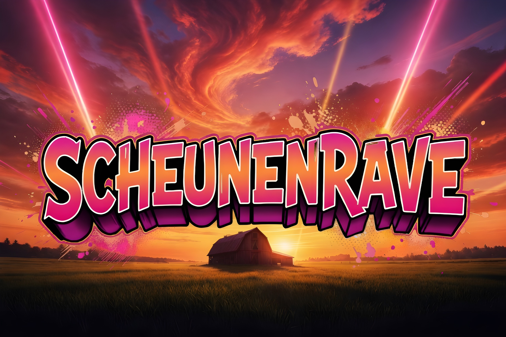

<!DOCTYPE html>
<html lang="de">
<head>
  <meta charset="UTF-8">
  <meta name="viewport" content="width=device-width, initial-scale=1">
  <title>Scheunenrave – Winter Edition</title>
  <meta name="description" content="Scheunenrave Winter Edition – 28.11. ab 17 Uhr, Scheune Niedersolbach 2, 51598 Friesenhagen">
  <meta property="og:title" content="Scheunenrave – Winter Edition">
  <meta property="og:description" content="28.11. – 17 Uhr · Scheune, Niedersolbach 2, 51598 Friesenhagen">
  <meta property="og:image" content="thumbnail.jpg">
  <link rel="preconnect" href="https://fonts.googleapis.com">
  <link rel="preconnect" href="https://fonts.gstatic.com" crossorigin>
  <link href="https://fonts.googleapis.com/css2?family=Bangers&display=swap" rel="stylesheet">
  
</head>
<body>
  <main>
    <h1>Scheunenrave</h1>
    
Winter Edition

    

      --:--:--
    

    
DHM

    

      28.11 - 17 Uhr 
      Scheune 
      Niedersolbach 2 
      51598 Friesenhagen
    

    

      Indoor 
      Bier vom Fass + Softdrinks 
      - Bring your own Cocktails -
    

    

      
      
    

    
Wer jemanden mitbringen möchte gerne melden, begrenzter Platz!

  </main>

  
</body>
</html>
